

<h1 align="center">UnrealQuest</h1>

<b>See every objective. Spend less time searching. Adventure more.</b>

Built from scratch for the <b>Unreal Azeroth / Emberveil</b> client -- not a fork or a port.

> [!IMPORTANT]
> ## Install
>
> 1. [Download the latest release](https://github.com/Tom75VN/UnrealQuest/releases/latest/download/UnrealQuest.zip).
> 2. Extract it into `Azeroth\Interface\AddOns\`.
> 3. Check that `UnrealQuest.toc` sits directly inside the `unrealQuest` folder.
> 4. Launch the game, or reload the interface.

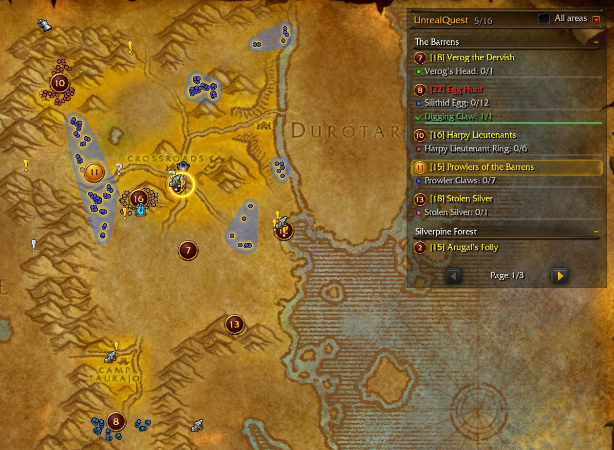

## Features at a glance

| | |
|---|---|
| [World map](#world-map) | Objective dots and areas, numbered quests, `!` / `?` markers, patrol paths, any zone |
| [Minimap](#minimap) | The same quest pins and areas around you, with tooltips |
| [Quest tracker](#quest-tracker) | Movable, resizable, unlimited, grouped by zone, live progress |
| [Quest navigator](#quest-navigator) | An on-screen arrow to the next objective, plus a second one for a tracked creature |
| [Immersive quest dialogue](#immersive-quest-dialogue) | Six themes, keyboard control, optional auto accept and hand-in |
| [Quest log](#quest-log) | Two full-height pages, Show / Track / Follow, levels, translations |
| [Rewards](#rewards) | Experience, reputation, best upgrade and best sale value |
| [Recognize quest targets](#recognize-quest-targets) | Tooltips, nameplate numbers, target-frame icon, raid marks |
| [Explore the world](#explore-the-world) | NPC finder, herbs and veins, chests, rares, dungeons, quest vendors |
| [Rare alert](#rare-alert) | A warning card and sound near a rare, elite or boss spawn |
| [Party](#party) | Shared-quest count and objective progress in party chat |
| [Languages](#languages) | English, French, Russian and Simplified Chinese |

## World map

Turn the world map into a questing compass.

- **Dots, areas or both** for every objective, each quest in its own colour that survives a relog.
- **Numbered quests** that match the tracker; a finished quest's number turns green.
- **`!` and `?` markers** for quests to take and to hand in; the `?` turns orange when the quest is ready.
- **Followed quest** stands out with a gold outline and a ring that pulses on its turn-in.
- **Hover a pin** to fade every other quest and light up that quest's turn-in.
- **Patrol paths** for moving quest NPCs, elites and vendors.
- **One tooltip for stacked pins**, listing every quest that shares a spawn.
- **Click a pin to follow its quest**; shift-click a `!` to mark a quest as done.
- **Any zone, not just yours** -- and Show (or ctrl-click in the tracker) opens the zone you actually need, across continents.
- **Cleaner map**: no other-faction givers, no profession quests you cannot do, no city guards or dungeon interiors.

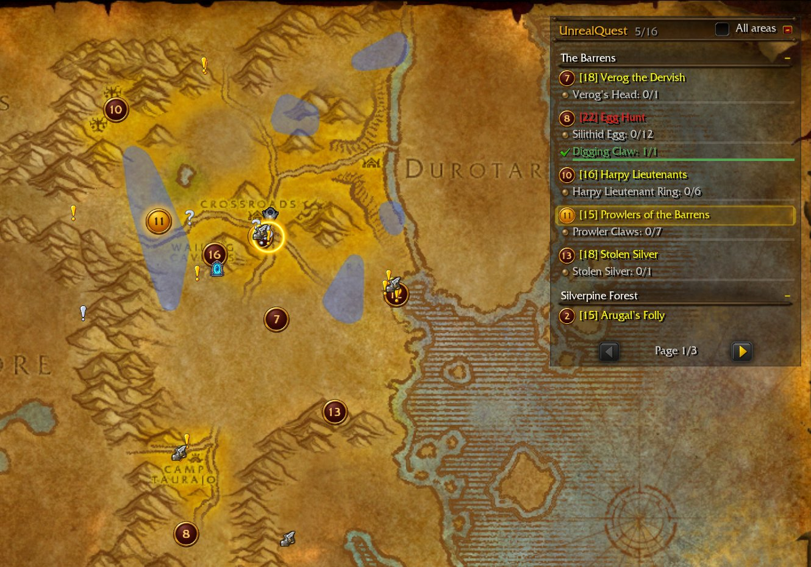

<table>
<tr>
<td width="50%">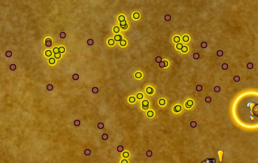 The followed quest's dots and turn-in ring</td>
<td width="50%">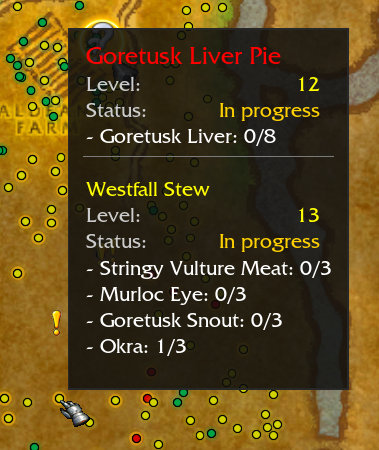 Two quests on the same spawn, one tooltip</td>
</tr>
<tr>
<td>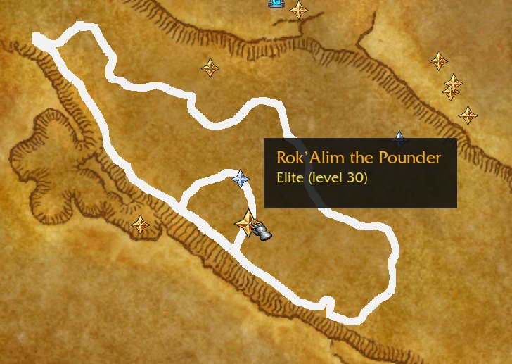 Patrol path of a roaming elite</td>
<td>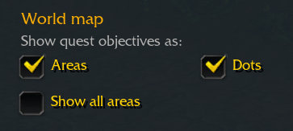 Areas, dots, or both</td>
</tr>
</table>

## Minimap

Nearby objectives, givers and turn-ins stay on the minimap while you move.

- The world map's dots and areas, drawn around you.
- A tooltip on every pin; click a pin to follow its quest.
- Off-screen `!` and `?` markers can stick to the edge, and your own arrow stays on top.
- Hover a quest in the tracker to enlarge its dots.

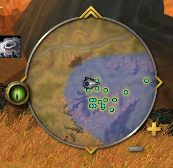

## Quest tracker

Every quest you need, in one movable window.

- **No five-quest limit**, grouped by zone, with live objective progress and quest levels.
- **Drag and resize** it; its position and tracked quests survive a reload.
- **Current zone only** -- including quests whose objectives are here but that the log files elsewhere, and dungeons.
- Optional progress bars, a hide-until-started filter, and fold / unfold per quest and zone.
- Elite and dungeon quests show a `+` after their level (`[11+]`).
- The followed quest glows gold; click a quest to follow it.
- The same tracker is shown on the world map.

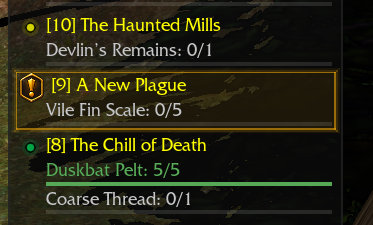

## Quest navigator

An arrow that tells you which way to turn.

- Points at the nearest objective of the followed quest -- or of any quest nearby when you follow none -- and switches to the turn-in once the quest is done.
- Shows the distance and an estimated travel time; it fades as the target moves behind you.
- Drag it anywhere; its position is saved.
- **Mob tracking**: search the creature database, track one creature, and a second arrow leads you to its nearest spawn while its spawns appear on both maps.

<table>
<tr>
<td width="33%">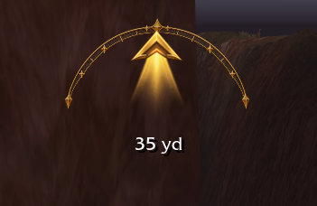 Straight ahead</td>
<td width="33%">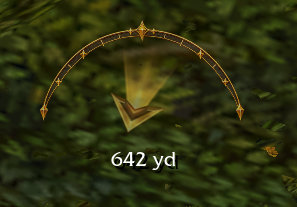 Behind you</td>
<td width="33%">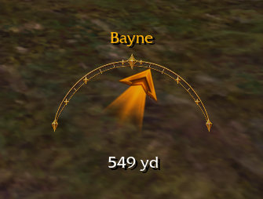 Tracked creature</td>
</tr>
</table>

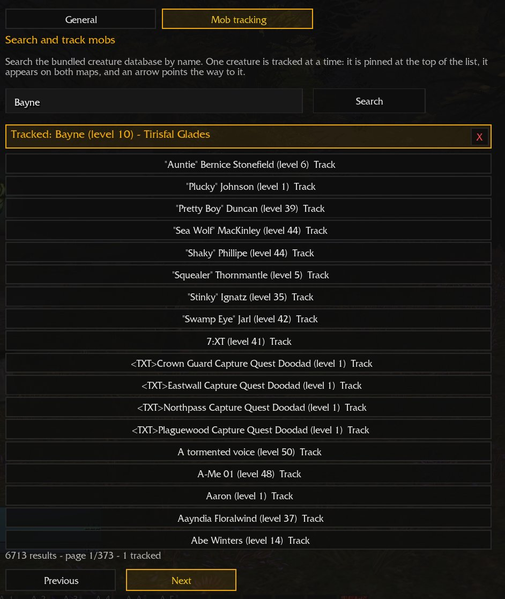

## Immersive quest dialogue

A replacement for the stock gossip and quest windows, with the NPC's portrait, paginated text, objectives and rewards.

- **Six themes**: Minimal, Parchment, Alliance, Horde, Alliance light and Horde light.
- **Conversation card** for gossip and greetings, **quest card** for offers, progress and rewards.
- **Keyboard control** (Space to accept, Esc to decline) and an option to hide the interface while talking.
- **Auto accept and complete** (off by default): quests are accepted and handed in for you; a choice of rewards is left to you.
- Language flags on every quest card to read that quest in another language.

<table>
<tr>
<td width="50%">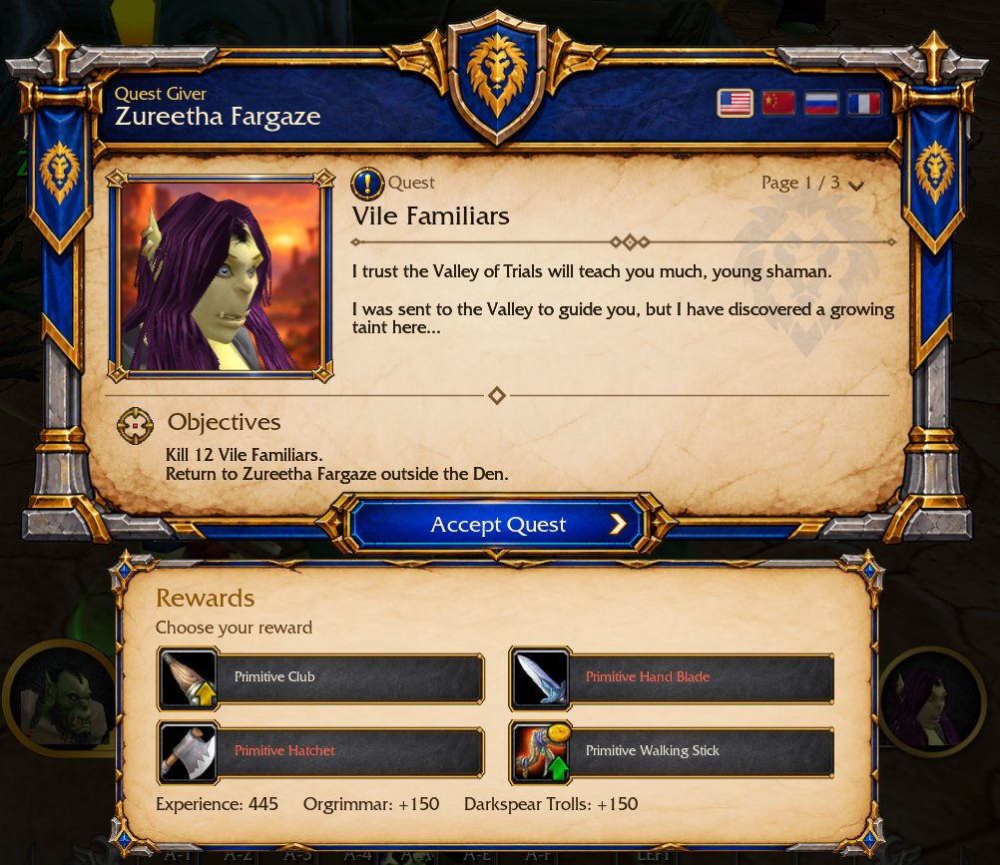 Alliance</td>
<td width="50%">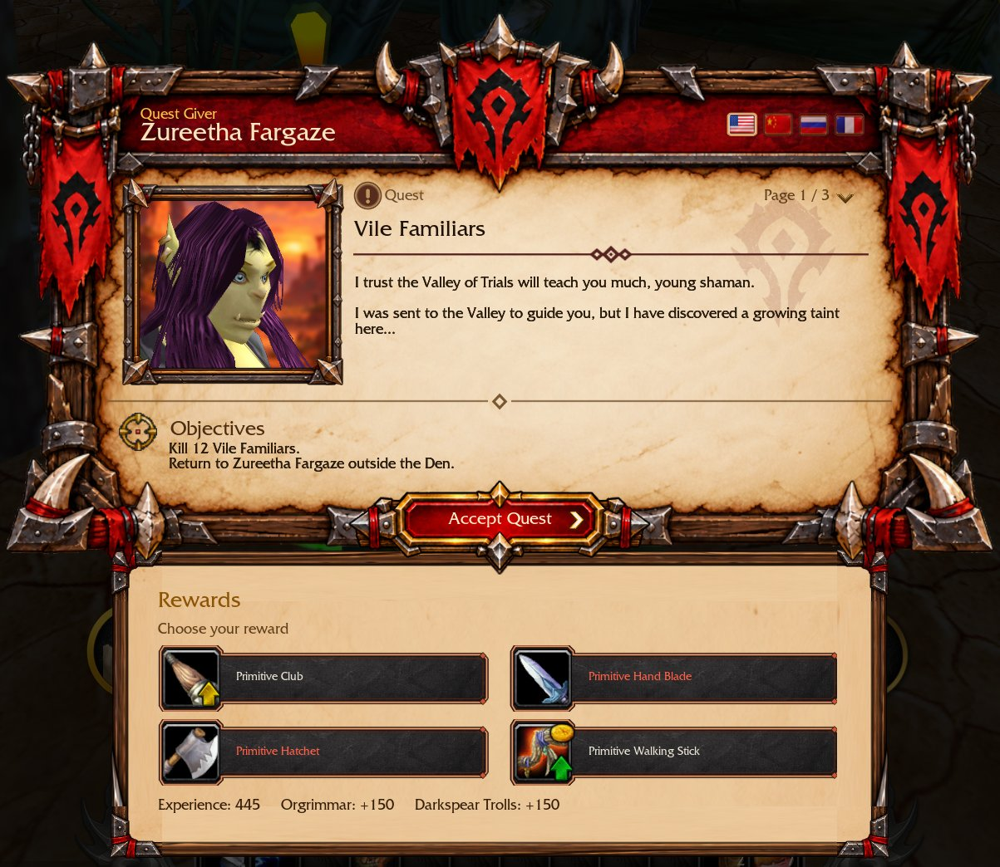 Horde</td>
</tr>
<tr>
<td>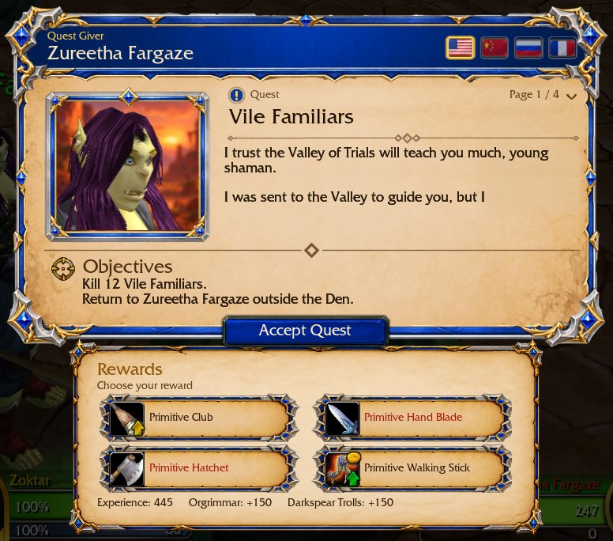 Alliance light</td>
<td>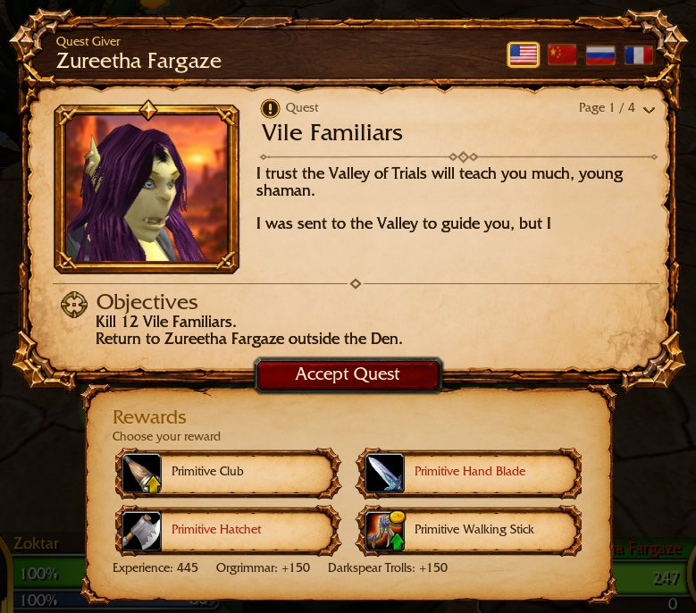 Horde light</td>
</tr>
<tr>
<td>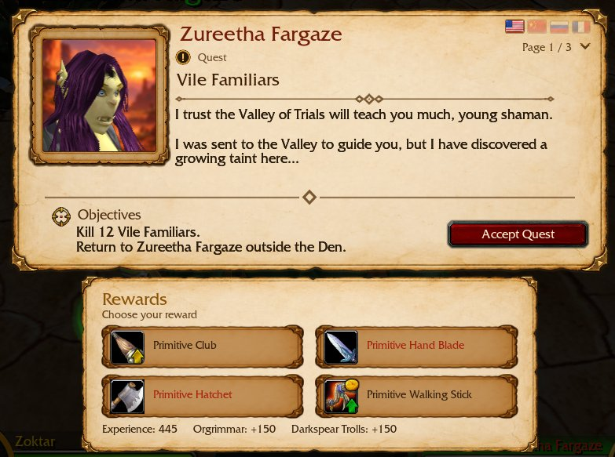 Parchment</td>
<td>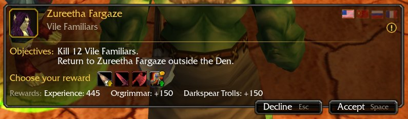 Minimal  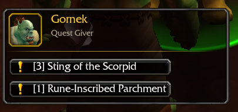 Minimal greeting</td>
</tr>
</table>

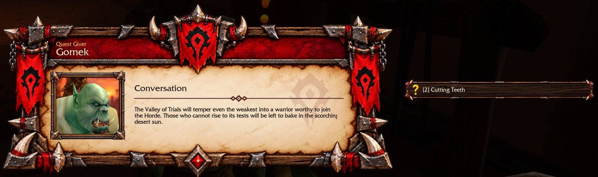

## Quest log

- **Two full-height pages**: the quest list on the left, the selected quest on the right (standalone and with unrealUI's Classic WoW theme; unrealUI's modern themes keep their own layout).
- **Show, Track and Follow** buttons on every quest.
- Quest levels, difficulty colours, and unlimited tracking from the log.
- **Language flags** to read one quest's title, objectives and description in another language.
- In a party, how many members share each quest.

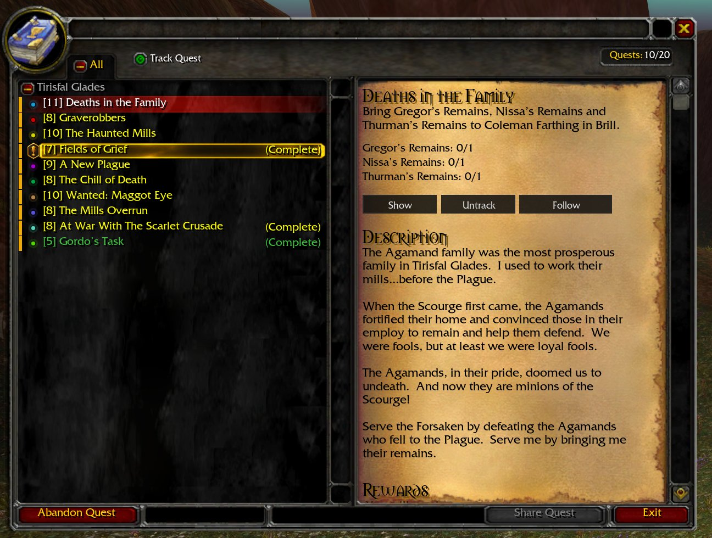

<table>
<tr>
<td width="50%">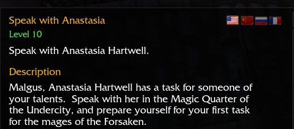 Per-quest language flags</td>
<td width="50%">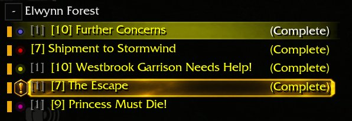 Party members on the same quest</td>
</tr>
</table>

## Rewards

- **Experience and reputation** on the quest log, the offer window and the turn-in window.
- **Gear advisor**: a green arrow on the best upgrade, yellow on the runner-up, red on a downgrade, and a coin on the reward that sells for the most.
- Reward names drawn in their item quality colour.

<table>
<tr>
<td width="50%">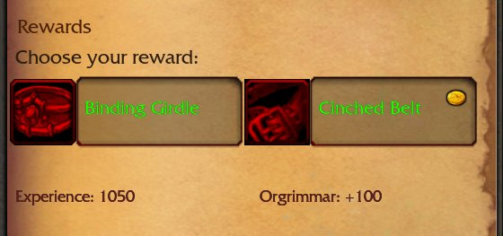 Best sale value and upgrades</td>
<td width="50%">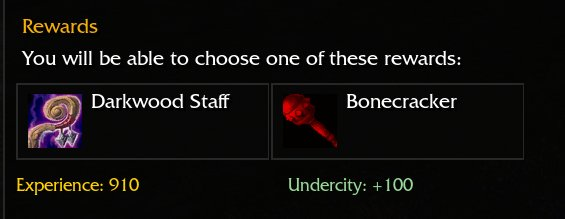 Experience and reputation</td>
</tr>
</table>

## Recognize quest targets

- **Creature tooltips** show the quest, your live progress and the item drop rate.
- **Respawn time** from the world data on creature and object tooltips.
- **Map tooltips** for bosses and elites list their loot with drop rates, with item comparison.
- **Nameplate number**: the quest's number next to a creature an objective still needs.
- **Target frame icon** while your target is a quest creature (unrealUI target frame).
- **Raid marks** over quest creatures (optional).

<table>
<tr>
<td width="33%">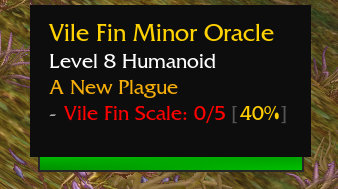 Progress and drop rate</td>
<td width="33%">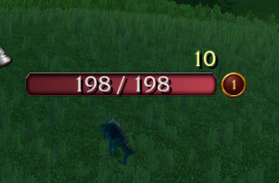 Nameplate quest number</td>
<td width="33%">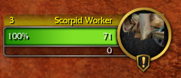 Target frame icon</td>
</tr>
<tr>
<td>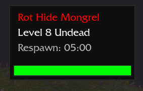 Respawn time</td>
<td colspan="2">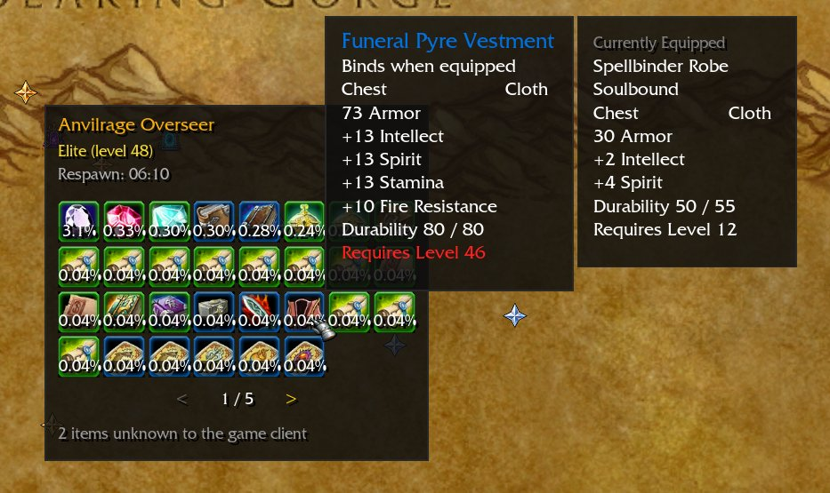 Loot and drop rates on the map</td>
</tr>
</table>

## Explore the world

Everything is picked from the tracker's spyglass menu and shown on both maps.

- **NPC finder**: auctioneers, bankers, battlemasters, flight masters, innkeepers, mailboxes, vendors and your class trainer.
- **Gathering**: treasure chests, fishing pools, and herbs and veins, each with its own icon and required skill.
- **Rare, elite and boss** creatures with a silver, gold or red star.
- **Dungeon and raid entrances** with their level range and required level.
- **Quest vendors**: when a quest needs an item a trader sells, the sellers are marked until you own it.

<table>
<tr>
<td width="33%">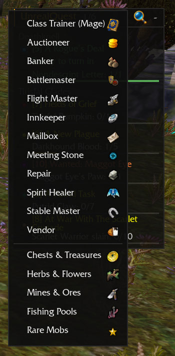 NPC finder</td>
<td width="33%">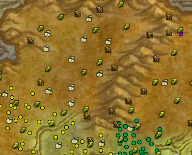 Herbs and veins</td>
<td width="33%">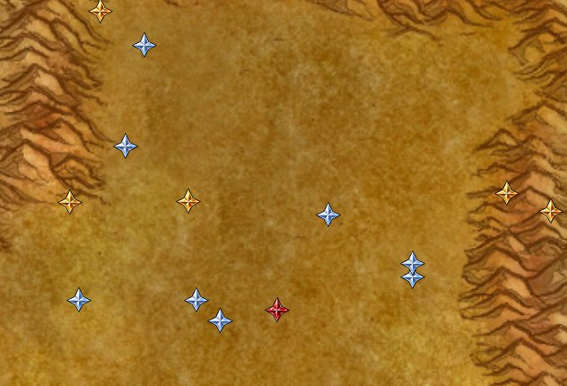 Rare, elite and boss</td>
</tr>
<tr>
<td>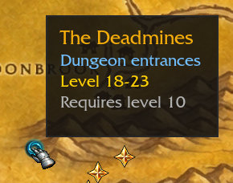 Dungeon entrance</td>
<td>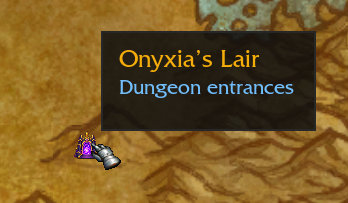 Raid entrance</td>
<td>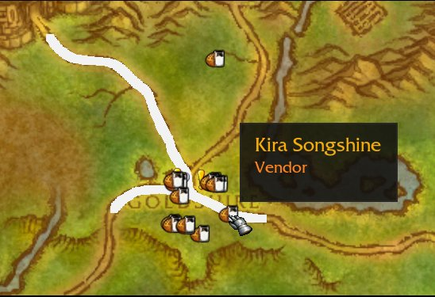 Vendors</td>
</tr>
</table>

## Rare alert

- A movable card when you come near a known rare, rare elite or boss spawn, with its rank, level, distance, direction and your kill count.
- Separate switches for rares, elites and bosses, an alert distance, and a sound you choose.

<table>
<tr>
<td width="60%">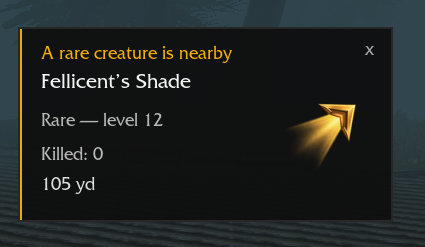</td>
<td width="40%">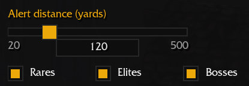</td>
</tr>
</table>

## Party

- Report your objective progress to the party, one line per step -- only for quests another member also has (off by default).
- Option to report completed objectives only.

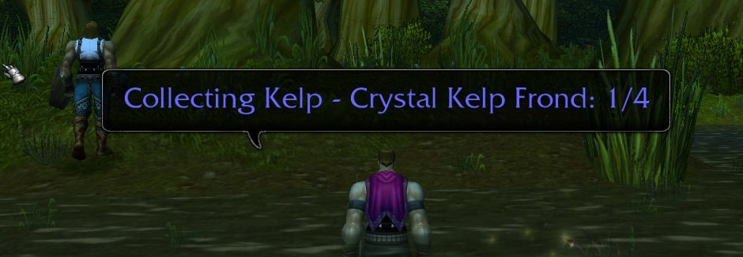

## Languages

- The interface ships in **English, French, Russian and Simplified Chinese**, picked with the flags in the settings window.
- With unrealUI installed, UnrealQuest follows unrealUI's language instead.
- Quest, creature and zone **names** follow your client's language, to match what the game shows.
- Quests themselves can be read in another language, one quest at a time, from the quest log and dialogue flags.

## Settings and commands

- A standalone settings window (General, Quest dialogue and Mob tracking tabs) that becomes an "UnrealQuest" entry in unrealUI's settings when it is installed.
- A settings button beside the minimap.
- **pfQuest import**: bring in pfQuest's completed-quest history so finished quests stay off the map; it can be undone.

| Command | What it does |
|---|---|
| `/uq` | List every command |
| `/uq config` | Open the settings |
| `/uq tracker on\|off\|reset` | Show, hide or reset the tracker |
| `/uq map dots\|areas\|both` | Choose how objectives are drawn |
| `/uq track <quest>` / `/uq untrack <quest>` | Track or untrack a quest |
| `/uq hide <quest>` / `/uq unhide <quest>` | Hide or restore a quest's map pins |
| `/uq marks on\|off` | Raid marks over quest creatures |
| `/uq pfquest import` | Import pfQuest's quest history |
| `/uq status` | What this build detected about the client |

## Version

Current release: **0.5.2**

## License

UnrealQuest is released under the MIT License. Bundled world data originates from VMaNGOS and was packaged by pfQuest under the MIT License. Imported artwork keeps its own provenance; see [LICENSE](LICENSE), [Database/CREDITS.md](Database/CREDITS.md) and [media/Textures/QuestLog/ATTRIBUTION.md](media/Textures/QuestLog/ATTRIBUTION.md).
